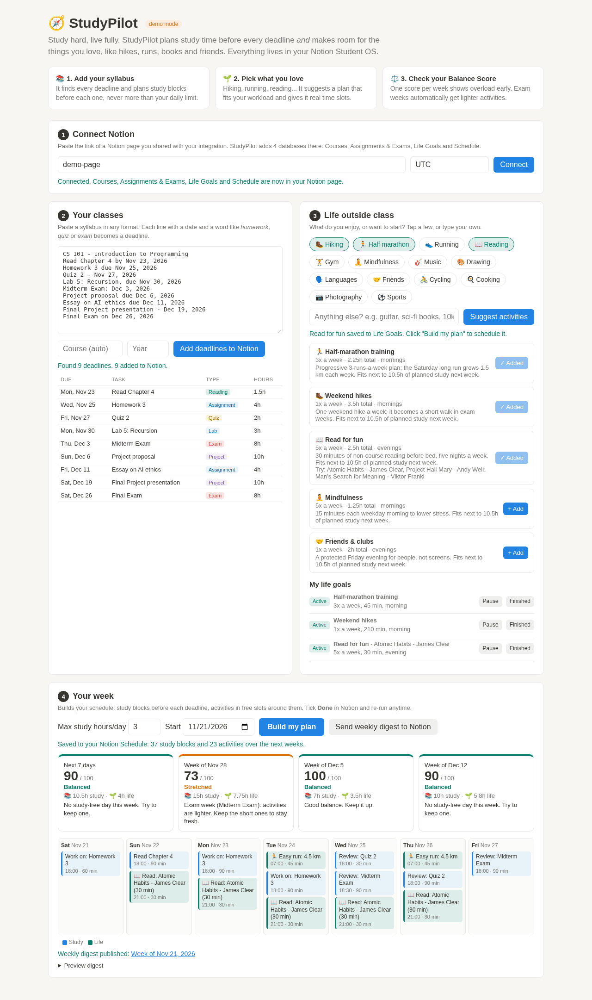

# StudyPilot 🧭

**Paste a syllabus. Get every deadline, a realistic study plan, and a weekly digest — inside your Notion Student OS.**

Built for the **Cognition × Notion Student OS Hackathon**, end to end with Devin.



## The problem

Every semester starts the same way: five syllabi, fifty deadlines, and an empty planner. Students copy dates into Notion by hand (or don't), then discover the midterm three days out. Knowing *when* things are due is not the same as knowing *when to work on them*.

## What StudyPilot does

| Step | What happens in Notion |
|---|---|
| **1. Connect** | Creates three linked databases under any page you choose: **Courses**, **Assignments & Exams**, **Study Sessions**. |
| **2. Import a syllabus** | Paste any syllabus text. StudyPilot finds every dated deadline (`Sep 15`, `9/26`, `2026-10-14`, `Friday, September 18`, `3rd December`…), classifies it (Exam, Project, Quiz, Lab, Reading, Assignment), estimates effort, links it to its course, and skips duplicates on re-import. |
| **3. Autopilot plan** | Schedules study blocks before each deadline: earliest deadline first, spread across the least-loaded days in a per-type lead window (exams 10 days, projects 14…), never exceeding your daily hours cap. Deadlines that can't fit are flagged **at risk**. Re-plan anytime: sessions you tick **Done** count as progress, and future unfinished ones are rescheduled. |
| **4. Weekly digest** | Publishes a "Week of …" Notion page: due this week (as to-dos), overdue items, hours planned per day, and at-risk warnings. |

Everything lives in normal Notion databases, so it works with Notion's calendar, board and timeline views, and with the rest of your Student OS.

## Quick start

```bash
git clone https://github.com/ratulhasanruhan/studypilot-notion && cd studypilot-notion
python3 -m venv .venv && . .venv/bin/activate
pip install -e ".[dev]"
```

### Try it without Notion (demo mode)

```bash
STUDYPILOT_DEMO=1 studypilot serve      # http://127.0.0.1:8000
```

### Connect your Notion

1. Go to <https://www.notion.so/profile/integrations> → **New integration** (Internal) → copy the secret.
2. In Notion, open the page that should hold your Student OS → **•••** → **Connections** → add your integration.
3. Run:

```bash
export NOTION_TOKEN=ntn_...
studypilot serve                        # web app
# or the CLI:
studypilot setup "https://www.notion.so/.../Student-OS-<id>" --timezone Asia/Dhaka
studypilot import examples/cs101_syllabus.txt --year 2026
studypilot plan                         # writes Study Sessions
studypilot digest                       # publishes this week's digest page
```

Every command takes `--dry-run`. `plan` and `digest` take `--today YYYY-MM-DD` for demos.

## How it works

```
syllabus text ──► syllabus.py (regex date finder + dateutil + keyword classifier)
                       │ Items
                       ▼
                 core.py ──► Notion API (Courses / Assignments & Exams / Study Sessions)
                       │ Items from Notion + Done hours
                       ▼
                 planner.py (EDF, load-balanced, daily cap) ──► Study Sessions
                       ▼
                 digest.py ──► "Week of …" Notion page
```

| File | Purpose |
|---|---|
| `studypilot/syllabus.py` | Deadline extraction and classification |
| `studypilot/planner.py` | Study-session scheduler |
| `studypilot/digest.py` | Weekly digest + Notion block rendering |
| `studypilot/core.py` | Orchestration, idempotent import, re-planning |
| `studypilot/notion.py` | Small Notion REST client with retry on rate limits |
| `studypilot/web.py`, `static/index.html` | FastAPI app + single-page UI |
| `studypilot/fake_notion.py` | In-memory Notion for tests and demo mode |

Config (database IDs, timezone, daily cap) is saved to `.studypilot.json`.

## Tests

```bash
pytest
```

CI runs the suite on Python 3.10 and 3.12.

## Example run (live Notion workspace)

Importing the two syllabi in [`examples/`](examples) into a real Student OS page on Nov 21, 2026:

```text
$ studypilot import examples/cse220_data_structures.txt --year 2026   # Created 8
$ studypilot import examples/mat216_linear_algebra.txt --year 2026    # Created 6
$ studypilot import examples/cse220_data_structures.txt --year 2026   # Created 0, skipped 8 duplicates
$ studypilot plan                                                     # 49 sessions written to Notion
$ studypilot digest
# Week of Nov 21, 2026
## Due this week
- Tue Nov 24 - Read Chapter 9 (Heaps) (Reading, CSE 220)
- Wed Nov 25 - Problem Set 7 (eigenvalues) (Assignment, MAT 216)
- Thu Nov 26 - Homework 5: Hash tables (Assignment, CSE 220)
## Study plan (12.5h)
- Sat Nov 21: 2.5h ... Fri Nov 27: 1.5h
Published: https://app.notion.com/p/Week-of-Nov-21-2026-...
```

## Built with Devin

StudyPilot was designed, coded, tested and connected to a live Notion workspace by Devin (Cognition) from a single chat request. See [SUBMISSION.md](SUBMISSION.md) for the hackathon write-up.

## License

MIT
