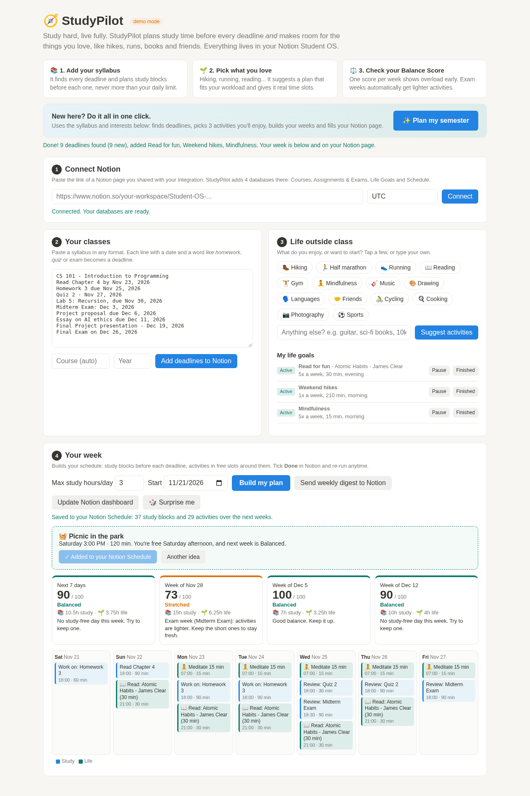

# 🧭 StudyPilot

**Study hard, live fully.** StudyPilot plans your study time *and* your life outside class, inside your Notion Student OS.

Built with Devin for the **Cognition × Notion Student OS Hackathon**.

| | |
|---|---|
| 🌐 **Try the web app** | [studypilot-notion.vercel.app](https://studypilot-notion.vercel.app) (demo mode, no sign-up) |
| 📒 **See it in Notion** | [Student Life HQ (live example)](https://app.notion.com/p/ratulhasan/Student-Life-HQ-54ebed5127cf83c9a24801acafeb200f) |
| 💻 **Code** | you're here |



## What it does

1. **📚 Paste your syllabus.** StudyPilot finds every deadline and books study time before each one, never more than your daily limit.
2. **🌱 Pick what you love.** Hiking, running, reading, music, friends... It suggests a plan that fits your workload and gives it real time slots that don't clash with study.
3. **⚖️ Check your Balance Score.** Every week gets a score out of 100 (Balanced, Stretched or Burnout risk) and one simple tip. In exam weeks, your activities get lighter instead of disappearing.

Everything is saved in normal Notion databases. Tick **Done** in Notion and the next plan adapts.

## Why it's different

| Normal planner | StudyPilot |
|---|---|
| Lists deadlines | Turns them into a day-by-day study plan |
| Only school | Also hikes, runs, books, hobbies and friends |
| Same plan every week | Exam weeks get lighter automatically |
| You notice overload too late | Balance Score warns you weeks ahead |

## What you get in Notion

- **Courses** and **Assignments & Exams**: every deadline with type, date and estimated hours
- **Life Goals**: your activities, how often, and what you're aiming for
- **Schedule**: every study block and activity, with a Done checkbox
- **Dashboard** on your page: Balance Score, next 7 days, due soon, life goals
- **Weekly digest** page: what's due, what's overdue, and this week's plan

## Run it in 1 minute

```bash
git clone https://github.com/ratulhasanruhan/studypilot-notion && cd studypilot-notion
python3 -m venv .venv && . .venv/bin/activate
pip install -e ".[dev]"
STUDYPILOT_DEMO=1 studypilot serve        # open http://127.0.0.1:8000 (demo data, no Notion needed)
```

Or run `make demo` to create the virtual environment, install dependencies, and start the demo.

### Connect your own Notion

1. Create an integration at [notion.so/profile/integrations](https://www.notion.so/profile/integrations) and copy its secret.
2. Open your Notion page → **•••** → **Connections** → add the integration.
3. Run `export NOTION_TOKEN=...` and `studypilot serve`, then paste your page link in step 1 of the app.

Prefer the terminal?

```bash
studypilot setup "<your Notion page link>" --timezone Asia/Dhaka
studypilot import examples/cse220_data_structures.txt --year 2026
studypilot suggest "hiking, half marathon, sci-fi books"
studypilot goal add hiking
studypilot plan          # writes your schedule, prints the Balance Score
studypilot dashboard     # refreshes the dashboard on your Notion page
studypilot digest        # publishes this week's digest page
```

## Deploy your own

[](https://vercel.com/new/clone?repository-url=https%3A%2F%2Fgithub.com%2Fratulhasanruhan%2Fstudypilot-notion)

Without a `NOTION_TOKEN` it runs in demo mode. Add `NOTION_TOKEN` in Vercel's environment variables to use your own workspace.

See the [deployment guide](docs/DEPLOY.md) for details.

## Project structure

```text
api/          Vercel entry point
studypilot/   Python package and web UI
tests/        Unit and API tests
examples/     Sample syllabi
docs/         Architecture, setup, deployment, and submission
```

- [Architecture](docs/ARCHITECTURE.md)
- [Notion setup and CLI guide](docs/NOTION_SETUP.md)
- [Vercel deployment](docs/DEPLOY.md)
- [Hackathon submission](docs/SUBMISSION.md)

Run the test suite with `make test` (also run on every push by GitHub Actions).

## Built with Devin

Devin (by Cognition) designed, coded, tested and deployed StudyPilot, and set up the live Notion workspace, from chat. See [docs/SUBMISSION.md](docs/SUBMISSION.md) for the hackathon write-up.

MIT license
