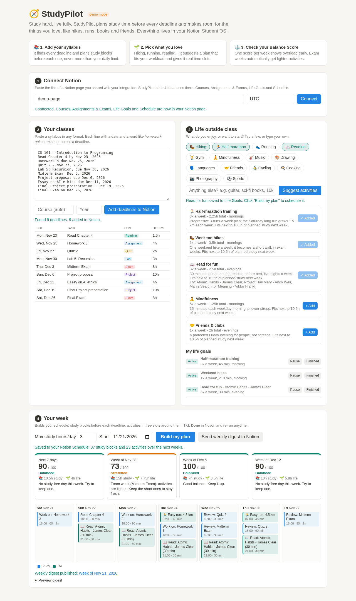

# StudyPilot — Cognition × Notion Student OS Hackathon submission

**One line:** Study hard, live fully. StudyPilot turns your syllabi into a study plan in Notion, then suggests and schedules the things that keep you sane (hikes, half-marathon training, books, friends) around it, and gives every week a Balance Score so you see burnout coming.

## Problem
Students get several syllabi per term with dozens of deadlines in inconsistent formats. Copying them into Notion is tedious, and a list of due dates doesn't tell you *when to study*. When the term gets busy, everything outside class goes first: exercise, reading for fun, hobbies, friends. Planners track coursework only, so these never get a slot and burnout follows.

## Solution
StudyPilot is a web app + CLI that plugs into Notion Student OS:

1. **Connect** – creates linked *Courses*, *Assignments & Exams*, *Life Goals* and *Schedule* databases under any Notion page.
2. **Import a syllabus** – extracts dated deadlines from free-form text, classifies them (Exam / Project / Quiz / Lab / Reading / Assignment), estimates hours, links the course, and de-duplicates on re-import.
3. **Autopilot study plan** – an earliest-deadline-first scheduler spreads study blocks before each deadline under a daily hours cap and flags deadlines that can't fit as *at risk*. Sessions marked Done count as progress on re-plan.
4. **Life beyond study** – type your interests ("hiking, half marathon, sci-fi books") and get activity suggestions sized to next week's study load: training plans, weekend hikes, a reading list, gym, mindfulness, music, languages, clubs and more (18 templates). Added activities become Life Goals in Notion and are scheduled in free slots that never clash with study. Plans progress week by week (long runs grow 1.5 km). In exam or heavy weeks they run about half as often and get shorter (a hike becomes a nature walk). Pause, resume or finish goals at any time.
5. **Balance Score** – every week gets a 0–100 score (Balanced / Stretched / Burnout risk) from study load, time for yourself, study-free days, exams and deadlines that won't fit, plus one plain-language tip such as "Exam week (Midterm): activities are lighter. Keep the short ones to stay fresh."
6. **Weekly digest** – a Notion page with the Balance Score, what's due, overdue items, study hours per day, risk warnings, this week's activities as to-dos, and last week's completion count.

## What makes it unique
- It plans **life, not just coursework**: activities get real calendar slots next to study blocks.
- **Exam-week mode** scales activities down instead of dropping them.
- The **Balance Score** turns "am I overdoing it?" into one number per week, weeks in advance.
- It all lives in Notion Student OS, with Done checkboxes feeding the next plan.

## How Devin and Notion were used
- **Devin (Cognition)** built the whole project from chat: product plan, Python package, Notion integration, study scheduler, life-activity engine, web UI, 30+ tests with CI, docs, and live runs against a real Notion workspace (14 deadlines from 2 syllabi plus 4 life goals, all scheduled together, then a weekly digest). When the user changed the scope from "study planner" to "student life planner", Devin redesigned and shipped it in the same session.
- **Notion** is the system of record: everything is regular Notion databases and pages, so calendar, board and timeline views of the Student OS work out of the box, and ticking Done in Notion drives the next plan.

## Screenshot

## Tech
Python 3.10+, FastAPI, Notion REST API (2022-06-28), python-dateutil, vanilla HTML/JS, pytest. An in-memory Notion fake powers tests and a no-token demo mode.

## Impact
- Setting up a course goes from ~30 minutes of copy-pasting to under a minute.
- Deadlines become a daily plan with a workload cap, which reduces cramming.
- Life goals get real calendar slots and shrink, rather than disappear, in exam weeks, so students keep running, reading and seeing friends all term.

## What's next
- LLM fallback for messy syllabus PDFs, and PDF upload.
- Google Calendar export of the Schedule.
- Scheduled weekly digests (cron / Notion automations).
- Learning from Done/skip history to tune hour estimates and activity frequency.

## Links
- Repo: https://github.com/ratulhasanruhan/studypilot-notion
- Demo video: <add link>
- Live Notion example: https://app.notion.com/p/ratulhasan/Student-Life-HQ-54ebed5127cf83c9a24801acafeb200f
